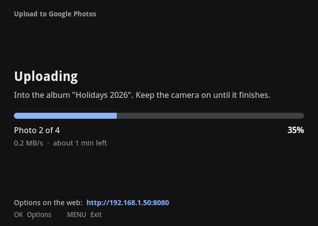
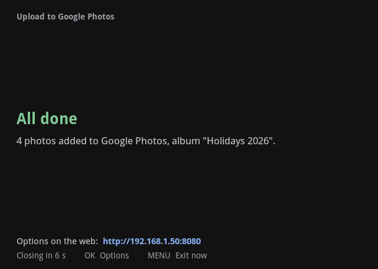
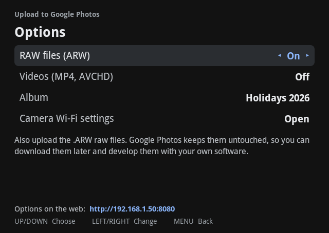

<p align="center">
  
</p>

<h1 align="center">Upload to Google Photos</h1>

<p align="center">
  <strong>From the camera straight to Google Photos.</strong>
</p>

<p align="center">
  A camera app for the Sony α6000 that uploads your photos to Google Photos over Wi-Fi.
</p>

## Skip the Cable

No computer, no phone, no cables: open the app on the camera and it uploads everything new by
itself. It joins a Wi-Fi network saved in the camera, uploads every new photo on the memory card
to your Google Photos library and closes itself.

## Features

- 📤 Automatic. Open the app and it connects, uploads what is new and closes itself 30 seconds after finishing.
- 🧠 Only once. It remembers what it already uploaded, even if you delete photos from the card or swap cards.
- 🎞️ RAW files. Optionally uploads the `.ARW` files; Google Photos keeps the original untouched so you can download and develop it later.
- 🎬 Videos. Optionally uploads MP4 and AVCHD; large videos continue where they stopped if the connection drops, even after closing the app.
- 🗂️ Albums. Optionally puts everything into an album of your choice.
- 🌐 Web page. The options can be changed on the camera screen or from a web page that the camera serves on your Wi-Fi network.

## Use It

1. Take photos as usual.
2. Within range of your Wi-Fi, open **MENU** → **Application** → **Application List** → **Upload to Google Photos**.
3. Wait until it says **All done**. It closes itself after 30 seconds (or press **MENU** to exit now).

| Option | What it does |
| --- | --- |
| RAW files (ARW) | Also uploads the `.ARW` raw files, about 25 MB of Google storage each |
| Videos (MP4, AVCHD) | Also uploads videos; large ones are sent in pieces |
| Album | *No album* (just the library) or one of the albums created with this app |

By default the app uploads JPG photos to your library, without an album. Change the options on
the camera (press **OK** while the app is open) or on the web page at the address shown at the
bottom of the camera screen (section **3. Upload options**). Google only lets the app use albums
it created itself; create them from the web page.

<p align="center">
  
  
  
</p>

## Install

Download **[upload-to-google-photos.apk](https://github.com/victor141516/sonia/releases/latest/download/upload-to-google-photos.apk)**
from the [latest release](https://github.com/victor141516/sonia/releases/latest) and install it
on the camera over USB with **pmca-gui** from [Sony-PMCA-RE](https://github.com/ma1co/Sony-PMCA-RE).
Then save your Wi-Fi network in the camera, create your own Google Cloud app (free) and sign in
to Google from the camera's web page. The first setup takes about 20–30 minutes; after that,
nothing.

- [Setup guide](docs/setup.md): what you need, every step with screenshots, everyday use and updating.
- [Troubleshooting](docs/troubleshooting.md): Wi-Fi, pmca-gui and Google sign-in errors.
- [Privacy and security](docs/privacy.md): what is stored, where, and how to revoke access.

To update, install the new `.apk` the same way. Your settings, sign-in and upload history are kept.

## Build

The build script runs on Windows and doesn't use Gradle. Requirements:

- Python 3 and a JDK (`javac`, `java`, `keytool` on the `PATH`).
- Android SDK (`ANDROID_HOME`, default `%LOCALAPPDATA%\Android\Sdk`) with **platforms;android-10** and **build-tools;37.0.0**.
- Android NDK **r14b**, the last one that targets Android 2.3. Set `NDK_R14B` to its folder.

```
set NDK_R14B=C:\path\to\android-ndk-r14b
python build.py
```

The result is `build/uploader.apk`. The first build creates `debug.keystore` to sign the app.
Keep it: Android only accepts updates signed with the same key, so your own build can't update
the release build (uninstall it first).

## Development

The Java sources are in `src/main/java`, the native TLS code (Mbed TLS) in `jni/`. There is no
automated test suite in this repository: `build.py` compiles against the API 10 boot classpath,
so newer Android/Java APIs fail at build time, and verifies the APK signature. On the camera,
the app writes a detailed log to `UPLOADER/LOG.TXT` on the memory card.

See [How it works](docs/how-it-works.md) and [Credits and license](docs/credits.md).

## Note

Runs on the camera's built-in app platform (*PlayMemories Camera Apps*) and has been tested only
on the **α6000 (ILCE-6000)**, which needs a **2.4 GHz** Wi-Fi network with Internet
access. The setup page has no password: while the app is open, anyone on the same Wi-Fi network
could open it, so use it on networks you trust. Uploads count against your Google account
storage, and Google limits each Cloud app to about 10,000 requests per day. Not affiliated with,
endorsed by or sponsored by Sony or Google.
