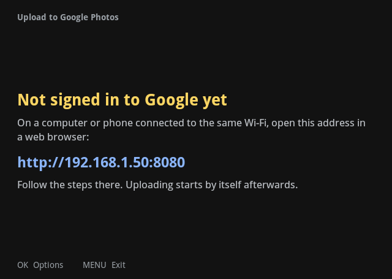
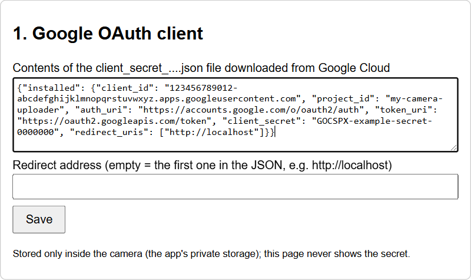
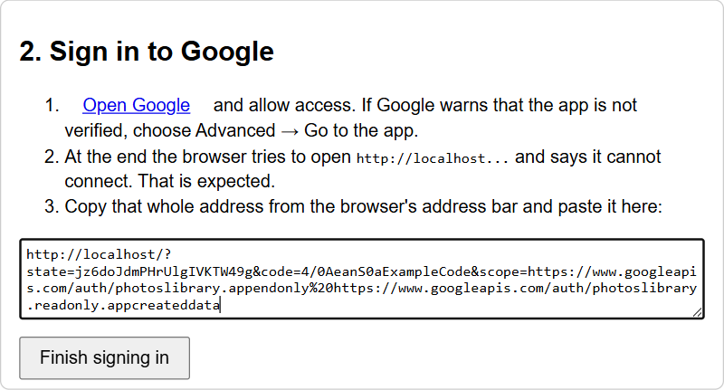
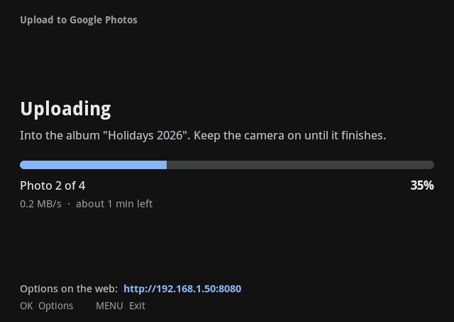
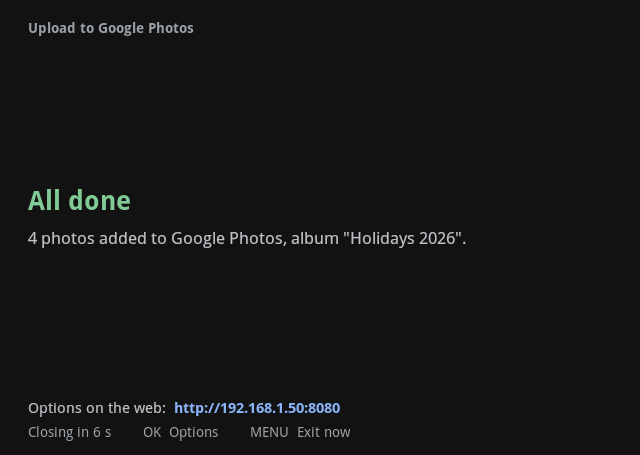
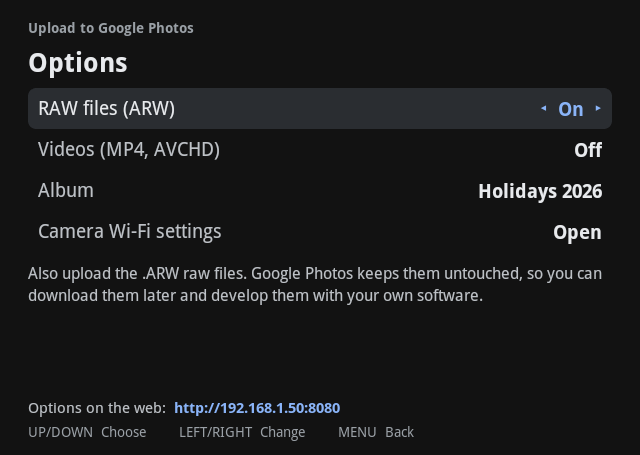
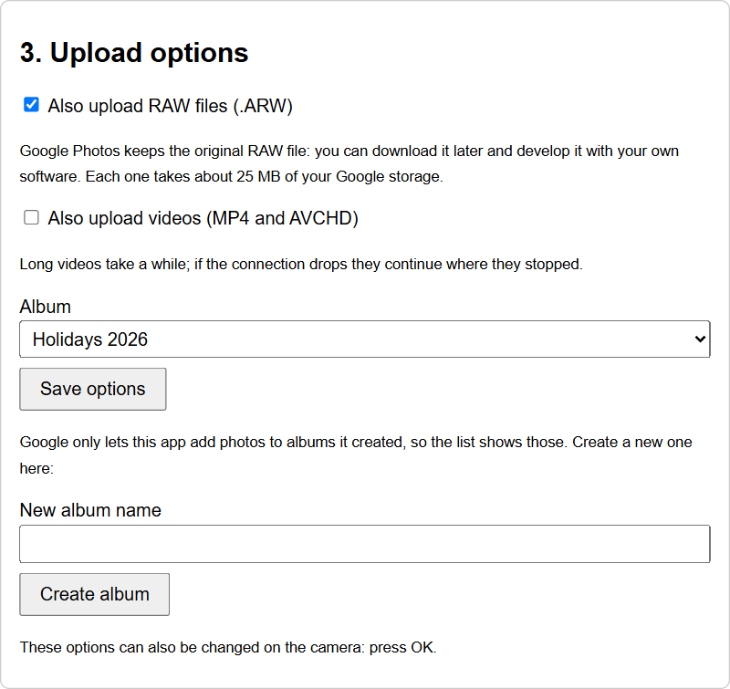

# Setup guide

Everything needed to install **Upload to Google Photos** on the camera and use it. See also [Troubleshooting](troubleshooting.md) and [Privacy and security](privacy.md).

## What you need

| | |
|---|---|
| **Camera** | Sony α6000 (ILCE-6000) with a charged battery and a memory card |
| **Computer** | Windows or macOS, only to install the app (once) |
| **USB cable** | The one that came with the camera (micro-USB) |
| **Wi-Fi** | A **2.4 GHz** network with Internet access (the α6000 does not support 5 GHz) |
| **Google account** | The one whose Google Photos library will receive the photos |
| **Time** | About 20–30 minutes for the first setup; after that, nothing |

## Step-by-step setup

### Step 1: Download the app

Download **[upload-to-google-photos.apk](https://github.com/victor141516/sonia/releases/latest/download/upload-to-google-photos.apk)** from the [latest release](https://github.com/victor141516/sonia/releases/latest) and save it somewhere easy to find, such as your Downloads folder.

### Step 2: Install the app on the camera

Sony closed its camera app store, so apps are installed with **pmca-gui**, a free open-source tool from the [Sony-PMCA-RE](https://github.com/ma1co/Sony-PMCA-RE) project.

#### 2.1 Download pmca-gui

Go to the [Sony-PMCA-RE latest release](https://github.com/ma1co/Sony-PMCA-RE/releases/latest) and download the file for your computer:

| Your computer | File to download (the version number may be newer) |
|---|---|
| Windows | `pmca-gui-v0.18-win.exe` |
| macOS | `pmca-gui-v0.18-osx.dmg` |

- **Windows:** nothing to install, just double-click the `.exe`. If Windows shows *"Windows protected your PC"*, click **More info** and then **Run anyway**.
- **macOS:** open the `.dmg` and drag the app to *Applications*. The first time, right-click the app and choose **Open** (macOS blocks apps from unknown developers on a normal double-click). Quit any app that may grab the camera over USB: Photos, Image Capture, Dropbox, Google Drive. If the camera is not found, install Sony's [Camera Driver for Mac](https://support.d-imaging.sony.co.jp/mac/driver/11/ja/).

#### 2.2 Prepare the camera

1. Turn the camera on.
2. Press **MENU** and go to **Setup** (the toolbox tab) → **USB Connection** → choose **Mass Storage**. (**MTP** also works; **PC Remote** does not.)
3. Connect the camera to the computer with the USB cable.

#### 2.3 Install

1. Open **pmca-gui**.
2. Go to the **Install app** tab.
3. Select **Select an apk**, click **Open apk...** and choose the `upload-to-google-photos.apk` you downloaded in step 1.
4. Click **Install selected app**.
5. Wait until the log at the bottom says **Task completed successfully** (about a minute). Don't disconnect the cable before that.
6. Disconnect the cable.

If pmca-gui says *"No devices found"*, see [Troubleshooting](troubleshooting.md#pmca-gui-says-no-devices-found).

### Step 3: Connect the camera to your Wi-Fi

You only do this once per network.

1. Press **MENU** and go to the **Wireless** tab → **Access Point Set.**
2. Choose your network, type its password and confirm.

The camera can remember several networks; the app joins whichever one is in range. You can also open these settings later from inside the app (press **OK** → *Camera Wi-Fi settings*).

### Step 4: Create your own Google Cloud app

Google only lets apps upload to Google Photos if they are registered in Google Cloud. Instead of sharing one registration for everybody, **each person creates their own** (free, no credit card needed). This keeps your access private to you, and you don't share Google's daily usage limits with anyone.

Do this on a computer, signed in to Google with **the same account whose Google Photos should receive the photos**.

#### 4.1 Create a project

1. Open **[console.cloud.google.com/projectcreate](https://console.cloud.google.com/projectcreate)** (accept the terms of service if it's your first time).
2. **Project name:** anything, for example `Camera uploader`. Click **Create**.
3. Wait a few seconds and make sure the new project is selected in the project picker at the top of the page.

#### 4.2 Enable the Photos Library API

1. Open **[the Photos Library API page](https://console.cloud.google.com/apis/library/photoslibrary.googleapis.com)**.
2. Click **Enable**.

#### 4.3 Configure the sign-in screen

1. Open **[Google Auth platform](https://console.cloud.google.com/auth/overview)** and click **Get started**.
2. **App information:** App name `Camera uploader` (or anything), User support email: your email. Click **Next**.
3. **Audience:** choose **External**. Click **Next**.
4. **Contact information:** your email. Click **Next**.
5. **Finish:** tick *I agree to the Google API Services: User Data Policy*, click **Continue** and then **Create**.

#### 4.4 Add the permissions the app needs

1. Open **[Data Access](https://console.cloud.google.com/auth/scopes)** and click **Add or remove scopes**.
2. At the bottom of the panel, under **Manually add scopes**, paste these two lines:
   ```
   https://www.googleapis.com/auth/photoslibrary.appendonly
   https://www.googleapis.com/auth/photoslibrary.readonly.appcreateddata
   ```
3. Click **Add to table**, then **Update**, then **Save** at the bottom of the page.

The first permission lets the app add photos and create albums. The second lets it list the albums it created itself. Neither lets it see the rest of your library.

#### 4.5 Publish the app

1. Open **[Audience](https://console.cloud.google.com/auth/audience)**.
2. Under **Publishing status** (it says *Testing*), click **Publish app** and confirm.

**Why:** while the app is in *Testing*, Google cancels the camera's sign-in every 7 days and you would have to sign in again each week. Once published, the sign-in lasts until you revoke it.

Publishing does **not** make anything public and nobody else gets access to your photos: only someone holding your app's credentials (the file you download next) could even ask for permission. Google may show a notice that the app needs verification. You can ignore it: verification is only for apps offered to the general public. The only consequence is a warning screen when you sign in (step 5.4).

#### 4.6 Create the credentials file

1. Open **[Clients](https://console.cloud.google.com/auth/clients)** and click **Create client**.
2. **Application type:** **Desktop app**. Name: anything, for example `Camera`. Click **Create**.
3. In the dialog that appears, click **Download JSON**. You get a file named like `client_secret_123456789012-abc....apps.googleusercontent.com.json`.

Download it right away and keep it private: Google may not show the secret again later. If you lose it, just create another client.

### Step 5: Start the app and sign in to Google

#### 5.1 Open the app on the camera

1. Press **MENU** → **Application** tab → **Application List** → **Upload to Google Photos**.
2. The app turns on Wi-Fi and connects (about 10 seconds). The first time, it shows a web address:

<p align="center"></p>

Leave the camera on this screen.

#### 5.2 Open the setup page

On a computer or phone **connected to the same Wi-Fi network**, open a web browser and type the address shown on the camera **exactly**, including `http://` and `:8080` (for example `http://192.168.1.50:8080`).

#### 5.3 Give the camera your credentials

1. Open the JSON file from step 4.6 with a text editor (Notepad, TextEdit…), select all and copy.
2. In section **1. Google OAuth client**, paste it into the big box. Leave *Redirect address* empty.
3. Click **Save**.

<p align="center"></p>

#### 5.4 Sign in to Google

In section **2. Sign in to Google**:

1. Click **Open Google**. A new tab opens with Google's sign-in.
2. Choose your Google account (the same one as in step 4).
3. Google shows **"Google hasn't verified this app"**. This is expected, because you are the developer of your own app: click **Advanced** and then **Go to Camera uploader (unsafe)**.
4. Google asks which permissions to give. Tick **all of them** (or *Select all*) and click **Continue**.
5. The tab then tries to open an address starting with `http://localhost/?state=...` and shows an error like *"This site can't be reached"*. **This is expected.**
6. Copy the **whole address** from that tab's address bar.
7. Go back to the camera's page, paste it into the box under step 3 and click **Finish signing in**.

<p align="center"></p>

The page should say **"Signed in. The camera is starting to upload your photos."** The sign-in code expires within minutes and works only once: if something fails, click **Open Google** again and repeat.

#### 5.5 Done

The camera starts uploading right away. When it finishes it shows a summary and closes itself 30 seconds later.

<p align="center">
  
  
</p>

### Step 6: Choose what to upload (optional)

By default the app uploads JPG photos to your library, without an album. You can change this at any time, either on the camera or on the web page.

**On the camera:** while the app is open, press **OK**.

| Key | Action |
|---|---|
| Up / Down (or turn the control wheel) | Choose a row |
| Left / Right (or turn the top dial) | Change the value |
| OK | Change the value, or open *Camera Wi-Fi settings* |
| MENU | Back |

<p align="center"></p>

**On the web page:** section **3. Upload options**, then **Save options**.

<p align="center"></p>

| Option | What it does |
|---|---|
| **RAW files (ARW)** | Also uploads the `.ARW` raw files. Google Photos stores them as originals that you can download later. Each one takes about 25 MB of your Google storage. |
| **Videos (MP4, AVCHD)** | Also uploads videos. Large ones are sent in pieces and continue where they stopped if the connection drops. |
| **Album** | Where new photos go: *No album* (just the library) or one of the albums created with this app. |

**About albums:** Google only lets this kind of app add photos to albums **that the app created itself**. That's why the list doesn't show the albums you made in Google Photos. To create one, type a name under **New album name** on the web page and click **Create album**. It's created in Google Photos, selected right away, and also appears in the camera's options. The list is refreshed from Google every time you open the app.

If you change *RAW* or *Videos* while the app is open, it looks for files again and uploads what's now included.

## Everyday use

1. Take photos as usual.
2. Within range of your Wi-Fi, open **MENU** → **Application** → **Application List** → **Upload to Google Photos**.
3. Wait until it says **All done**. It closes itself after 30 seconds (or press **MENU** to exit now).

Good to know:

- Only new files are uploaded. The app remembers what it uploaded, even if you later delete photos from the card or swap cards.
- Keep the camera on while it uploads. If the battery drops below 15 %, the app stops and continues next time.
- If the connection is lost, the next run uploads the rest.
- The setup page is available every time the app is open, at the address shown at the bottom of the camera screen.
- Uploads count against your Google account storage (they're stored in original quality).
- Google limits each Cloud app to about 10,000 requests per day, roughly one per photo. If you reach it, the app says so and uploads the rest the next day.

## Updating the app

Download the new `.apk` from the [releases page](https://github.com/victor141516/sonia/releases) and install it exactly like in [step 2](#step-2-install-the-app-on-the-camera). Your settings, sign-in and upload history are kept.
